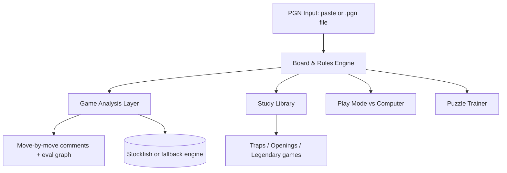

# ♟️ Chess Learning App — Project Documentation

**Project owner:** Randi Atewoung
**Skill level:** ~1500 Elo (chess.com)
**Goal:** A personal chess training app to learn traps, openings, tactics, strategy, and legendary games — with a comment on **every move** to understand the purpose of each one.

---

## 1. Objectives & Success Criteria

| Objective | Success criteria |
|---|---|
| Analyze my own games | Import PGN (paste or file), replay with per-move evaluation and comments |
| Understand every move | Each move gets an evaluation + a plain-English explanation |
| Learn theory | Traps, opening lines, plans, legendary annotated games |
| Practice tactics | Puzzle trainer by theme (forks, pins, back-rank, etc.) |
| Play practice | Computer opponent with adjustable strength (~800–1800 Elo) |

---

## 2. Architecture Overview

### Modules

1. **Board & Rules Engine** — full legality (castling, en passant, promotion, checks), PGN read/write. *Phase 1*
2. **Game Analysis** — evaluation per move, blunder/mistake/inaccuracy flags, best-move suggestion, evaluation graph, teaching comments. *Phase 2*
3. **Study Library** — annotated content with a comment on every move. *Phase 3*
4. **Play Mode** — adjustable computer opponent (easy → hard). *Phase 3*
5. **Puzzle Trainer** — themes: fork, pin, discovered attack, back-rank, traps. *Phase 4*

---

## 3. Technical Decisions

| Decision | Choice | Rationale | Fallback |
|---|---|---|---|
| Analysis engine | Stockfish 19 lite, single-threaded WASM (1.8 MB, in `public/engine/`) | Strong, small, needs no special server headers | Stockfish 19 asm.js build (slower, runs in any browser); clear message if both fail |
| Game input | PGN paste **and** file upload | Both requested by user | Paste only |
| Opponent strength | Adjustable ~800–1800 Elo | Matches user level and progression path | Fixed 1500 |
| Language of annotations | English | Doubles as English learning practice | — |
| Build approach | Phased, test each phase before moving on | Iterative beats one-shot; each phase is usable alone | — |
| Hosting | Cloudflare Pages at `chess.randivague.org` | Everything runs in the browser, so no server is needed | Google Cloud VM (Undercover) only if a backend is ever needed |

---

## 4. Roadmap & Status

- [x] **Phase 1 — Interactive board**: move validation, all special moves, PGN import, navigation — *approved 2026-10-15*
- [ ] **Phase 2 — Game analysis**: per-move evaluation, comments on every move, eval graph — *built, waiting for Randi's approval*
  - Feedback round 1: section tabs (My games / Review, future sections shown as "soon"), saved games with their analysis (localStorage), page no longer jumps when stepping through moves, move controls fixed at the bottom on phones.
- [ ] **Phase 3 — Study library + play mode**: annotated traps/openings/legendary games, adjustable computer opponent
- [ ] **Phase 4 — Puzzles**: themed tactics trainer

**Rule:** each phase must be tested and approved by Randi before starting the next. The current version is the stable base — never rebuild from scratch.

---

## 5. Comment System (the heart of the app)

Every move gets annotations from **three layers**:

1. **Engine layer** — evaluation score, classification (blunder / mistake / inaccuracy / best), suggested better move
2. **Teaching layer** — plain-English explanation of the move's purpose: tempo, weakness created/attacked, plan followed, tactical pattern (e.g. "this follows the Légal trap pattern")
3. **Reference layer** (study library only) — hand-written rich annotations for legendary games

## 6. Risks & Mitigations

| Risk | Mitigation |
|---|---|
| Stockfish can't load in the app | Custom fallback engine, same teaching experience |
| Losing work between sessions | Docs + phased approach; each phase is a stable base |
| Session/usage limits | Small, focused phases; resume from docs |
| Bugs in special moves (castling, en passant) | Use battle-tested chess logic, test each phase |

---

### How moves are graded

Each position is searched by Stockfish (MultiPV 2). Scores become White's win chance with the Lichess formula `2 / (1 + e^(−0.00368208·cp)) − 1`. The win chance the mover loses decides the label: ≥ 0.3 blunder, ≥ 0.2 mistake, ≥ 0.1 inaccuracy. The engine's own top move is always "best". When two neighbouring evaluations contradict each other, both positions are searched 6 plies deeper. Accuracy per move uses the Lichess formula and is averaged per player.

### How explanations are made

`src/teach.ts` reads the board (chess.js) and the engine lines. It names hanging pieces, forks and double attacks, pins (only those that matter: to the king, the queen, or a minor piece in front of a rook), discovered and double checks, recaptures, development, central pawns and castling. For bad moves it says what goes wrong, in this order: a forced mate allowed or missed, material lost (counted from before the move so fair trades are not called losses), a missed win when it explains most of the drop, the opponent's tactic, and otherwise the evaluation change. Every tactical claim must be confirmed by the board or the engine line.

*Last updated: 2026-10-15 — Phase 2 built (Stockfish analysis, move grades, explanations, eval bar and graph), waiting for approval.*
