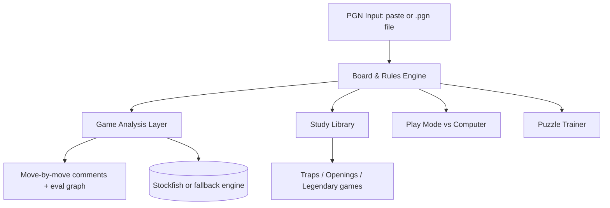

# ♟️ Chess Learning App — Project Documentation

**Project owner:** Randi Atewoung
**Skill level:** ~1500 Elo (chess.com)
**Goal:** A personal chess training app to learn traps, openings, tactics, strategy, and legendary games — with a comment on **every move** to understand the purpose of each one.

---

## 1. Objectives & Success Criteria

| Objective | Success criteria |
|---|---|
| Analyze my own games | Import PGN (paste or file), replay with per-move evaluation and comments |
| Understand every move | Each move gets an evaluation + a plain-English explanation |
| Learn theory | Traps, opening lines, plans, legendary annotated games |
| Practice tactics | Puzzle trainer by theme (forks, pins, back-rank, etc.) |
| Play practice | Computer opponent with adjustable strength (~800–1800 Elo) |

---

## 2. Architecture Overview

### Modules

1. **Board & Rules Engine** — full legality (castling, en passant, promotion, checks), PGN read/write. *Phase 1*
2. **Game Analysis** — evaluation per move, blunder/mistake/inaccuracy flags, best-move suggestion, evaluation graph, teaching comments. *Phase 2*
3. **Study Library** — annotated content with a comment on every move. *Phase 3*
4. **Play Mode** — adjustable computer opponent (easy → hard). *Phase 3*
5. **Puzzle Trainer** — themes: fork, pin, discovered attack, back-rank, traps. *Phase 4*

---

## 3. Technical Decisions

| Decision | Choice | Rationale | Fallback |
|---|---|---|---|
| Analysis engine | Stockfish 19 lite, single-threaded WASM (1.8 MB, in `public/engine/`) | Strong, small, needs no special server headers | Stockfish 19 asm.js build (slower, runs in any browser); clear message if both fail |
| Game input | PGN paste **and** file upload | Both requested by user | Paste only |
| Opponent strength | Adjustable ~800–1800 Elo | Matches user level and progression path | Fixed 1500 |
| Language of annotations | English | Doubles as English learning practice | — |
| Build approach | Phased, test each phase before moving on | Iterative beats one-shot; each phase is usable alone | — |
| Hosting | Cloudflare Pages at `chess.randivague.org` | Everything runs in the browser, so no server is needed | Google Cloud VM (Undercover) only if a backend is ever needed |

---

## 4. Roadmap & Status

- [x] **Phase 1 — Interactive board**: move validation, all special moves, PGN import, navigation — *approved 2026-10-15*
- [x] **Phase 2 — Game analysis**: per-move evaluation, comments on every move, eval graph — *approved 2026-10-15*
  - Feedback round 1: section tabs (My games / Review, future sections shown as "soon"), saved games with their analysis (localStorage), page no longer jumps when stepping through moves, move controls fixed at the bottom on phones.
  - Feedback round 2: grade badges on the moved piece (Lichess glyphs), explanation shown first.
  - Variations: the game is a move tree. Playing a different move starts a variation instead of erasing the game; PGN variations, comments and NAGs are read and written (own movetext parser, chess.js validates each move); "Play the … line" adds the engine's line as a variation; "Make main line" and "Delete from here"; every line is analyzed; variations are saved with the game. Accuracy counts the main line only.
- [x] **Theme editor** (between Phase 2 and 3): Settings page (⚙) with System / Light / Dark theme, six board color presets plus custom square colors, five accent colors, nine piece sets (Lichess sets with free licenses only, credited in `public/pieces/CREDITS.md`), coordinates on/off, live preview. Saved in the browser. *Approved 2026-10-15.*
- [ ] **Phase 3A — Play against the computer**: strength 800–1800 (own weakening: depth by level + a random choice among Stockfish's 6 best moves, weighted by how much each loses; Stockfish's UCI_Elo stops at ~1320), choose your color, hint / take back / resign, game saved during play, "Review this game" saves it to My games and analyzes it. *Built, waiting for Randi's approval.*
- [ ] **Phase 3B — Study library**: traps, openings, legendary games with a comment on every move.
  - Part 1 (built, waiting for approval): 14 traps — 3 in Randi's openings (Alekhine ×2, Catalan setup) and 11 classics — each with a comment on every move, the right move as a variation, ✓ Do / ✗ Don't, and "Test yourself". Every line is checked by Stockfish in `src/study/traps.test.ts` (the mistake costs, the trap wins, the recommended moves hold).
  - Part 2: opening chapters with Learn + Practice (an opening trainer: you play your side from memory; the computer plays the opponent along one line at a time; moves outside the repertoire are judged by the engine as playable or a mistake; progress per line, with lines missed coming back first). Every repertoire move is checked by Stockfish in `src/study/openings.test.ts` (within 0.5 pawn of the best, or a simpler move keeping +0.8).
    - White repertoire (done): Catalan vs ...d5/...e6; vs ...d5 and ...c5 (play c4 — Tarrasch with g3; 3.c3 is passive and e4 must be prepared); vs 1...c5 (the c3 plan, but d4 at once vs ...d5); vs the King's Indian setup.
    - Black vs 1.e4, Alekhine (done): Modern 4.Nf3 with ...g6 (vs 5.Bc4/c4/Be2/Ng5, and 7.Ng5 met by ...d5); 4.c4 Exchange and Four Pawns (...f6 break); sidelines 2.Nc3, Chase, 3.Nc3, 3.Bc4, 2.d3.
    - Black vs 1.d4, QGD setup (done): 2.c4 with Bg5 (Lasker ...h6/...Ne4), Exchange and Bf4 (...c5); the London (...c5, ...Bd6); the Catalan (...dxc4, ...a6, ...b5, ...Bb7, never ...c6).
    - Study library reorganized: Openings / Traps / Famous games (soon) tabs; a Continue box (last chapter, lines to review linking straight into Practice); progress overview per repertoire and traps studied; search, side and status filters. A trap counts as studied when its test is solved without "Show the answer".
    - Next: legendary games; more chapters on request (Randi's own trap list, lost games).
- [ ] **Phase 3 — Study library + play mode**: annotated traps/openings/legendary games, adjustable computer opponent
- [ ] **Phase 4 — Puzzles**: themed tactics trainer — *built, waiting for Randi's approval*
  - 1,150 puzzles chosen from the Lichess puzzle database (CC0, 6.2M puzzles): rated 900–2100, well tested (RD ≤ 80, popularity ≥ 85, ≥ 2000 plays), about 6 per 100 rating points in each of 16 themes. Selection script: `scripts/select-puzzles.mjs`. Every solution is replayed with chess.js; a sample of 40 is checked against Stockfish in `src/puzzles/data.test.ts`.
  - Training by theme (with the idea of each theme), an Elo puzzle rating (K = 40 for the first 20 puzzles, then 20), missed puzzles (wrong move, hint or solution shown) coming back as unrated reviews after 5 others. Any checkmating move is accepted, as on Lichess.

**Rule:** each phase must be tested and approved by Randi before starting the next. The current version is the stable base — never rebuild from scratch.

---

## 5. Comment System (the heart of the app)

Every move gets annotations from **three layers**:

1. **Engine layer** — evaluation score, classification (blunder / mistake / inaccuracy / best), suggested better move
2. **Teaching layer** — plain-English explanation of the move's purpose: tempo, weakness created/attacked, plan followed, tactical pattern (e.g. "this follows the Légal trap pattern")
3. **Reference layer** (study library only) — hand-written rich annotations for legendary games

## 6. Risks & Mitigations

| Risk | Mitigation |
|---|---|
| Stockfish can't load in the app | Custom fallback engine, same teaching experience |
| Losing work between sessions | Docs + phased approach; each phase is a stable base |
| Session/usage limits | Small, focused phases; resume from docs |
| Bugs in special moves (castling, en passant) | Use battle-tested chess logic, test each phase |

---

### How moves are graded

Each position is searched by Stockfish (MultiPV 2). Scores become White's win chance with the Lichess formula `2 / (1 + e^(−0.00368208·cp)) − 1`. The win chance the mover loses decides the label: ≥ 0.3 blunder, ≥ 0.2 mistake, ≥ 0.1 inaccuracy. The engine's own top move is always "best". When two neighbouring evaluations contradict each other, both positions are searched 6 plies deeper. Accuracy per move uses the Lichess formula and is averaged per player.

### How explanations are made

`src/teach.ts` reads the board (chess.js) and the engine lines. It names hanging pieces, forks and double attacks, pins (only those that matter: to the king, the queen, or a minor piece in front of a rook), discovered and double checks, recaptures, development, central pawns and castling. For bad moves it says what goes wrong, in this order: a forced mate allowed or missed, material lost (counted from before the move so fair trades are not called losses), a missed win when it explains most of the drop, the opponent's tactic, and otherwise the evaluation change. Every tactical claim must be confirmed by the board or the engine line.

*Last updated: 2026-10-15 — Phase 2 built (Stockfish analysis, move grades, explanations, eval bar and graph), waiting for approval.*
